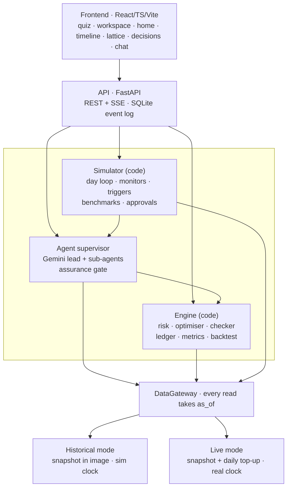
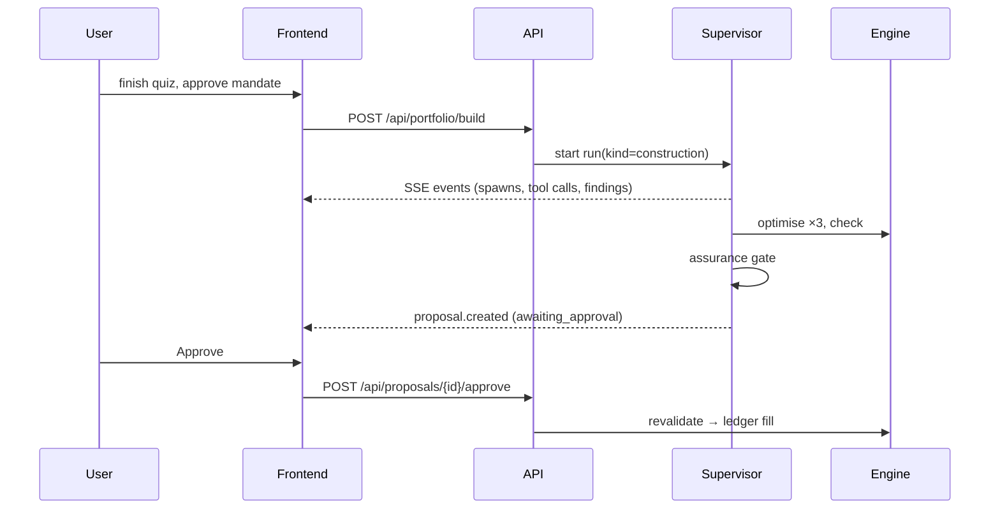

# 02 · Architecture

## 1. Principles

1. **One system, two clocks.** All code asks `clock.now()`. Historical mode = a simulated date; live mode = real time. Only the data adapters differ.
2. **The data firewall.** Every read goes through `DataGateway` with `as_of`. Anything published after `as_of` is refused and logged (`asof.violation`).
3. **Agents propose; code decides the numbers.** The deterministic engine computes risk, weights, costs and limit checks. Agents call it as tools and cannot change it.
4. **A cheap daily loop; agents only on schedule or trigger.** The daily step is pure code. Gemini runs on fortnightly reviews, triggers, construction and chat.
5. **Everything is an event.** Append-only typed events in SQLite are streamed over SSE. The UI renders events, and replay means re-reading them.

## 2. Layers

## 3. Components

| Component | Path | Responsibility | Owner |
|---|---|---|---|
| Settings | `backend/app/settings.py` | Env vars: mode, keys, LLM mode, paths | Jin |
| Clock | `backend/app/core/clock.py` | `SimClock` / `LiveClock`; single source of "now" | Jin |
| Events | `backend/app/core/events.py` | `Event` model, `EventBus.emit`, SQLite persistence, async subscribers for SSE | Jin |
| DataGateway | `backend/app/data/gateway.py` | Prices, FX, news, filings, catalogue, all filtered by `as_of`; freshness/coverage | Jin |
| Snapshot | `backend/app/data/snapshot.py` | Loads `data/snapshot/*` into memory | Jin |
| Adapters | `backend/app/data/adapters/` | EODHD, Alpaca, Finnhub, EDGAR (live top-up + fetch script) | Jin |
| Profile | `backend/app/profile/quiz.py` | Questions, scoring, profile → mandate | Jin |
| Risk | `backend/app/engine/risk.py` | Returns, Ledoit-Wolf covariance, correlation, vol, drawdown, beta | Cem |
| Optimiser | `backend/app/engine/optimiser.py` | CVXPY constrained allocation; 3 variants | Cem |
| Checker | `backend/app/engine/checker.py` | Numbers verifier + mandate checker + pre-execution revalidation | Cem |
| Ledger | `backend/app/engine/ledger.py` | Paper positions, cash, fills with costs + FX, fees, P&L | Cem |
| Metrics / backtest / exposure | `backend/app/engine/*.py` | Performance stats, as_of-bounded backtests, look-through exposure | Cem |
| Monitors | `backend/app/monitors/` | Trigger rules, cooldowns, monitor templates | Cem |
| Simulator | `backend/app/sim/` | Day loop, contributions, review schedule, benchmarks, approval policy | Cem |
| LLM wrapper | `backend/app/agents/llm.py` | Gemini via `google-genai`, structured output, cache, fake mode | Dev |
| Supervisor | `backend/app/agents/supervisor.py` | Runs agent trees; enforces depth/headcount/parallel/budget | Dev |
| Roles + prompts | `backend/app/agents/roles.py`, `prompts/` | Role registry: model, tools, can_spawn, output schema | Dev |
| Tools | `backend/app/agents/tools.py` | Tool registry wrapping engine + gateway; emits tool events | Dev |
| Gate + guard | `backend/app/agents/gate.py`, `guard.py` | Assurance gate runner; injection guard | Dev |
| API routes | `backend/app/api/` | REST + SSE per `04-api-contracts.md` | Jin |
| Frontend | `frontend/` | All screens; mock mode from `fixtures/` | Mo |

## 4. Main flows

**Construction:**

**Simulation day** (see 03-how-it-works §3 for the full loop): clock tick → fills → mark-to-market → contributions → risk → monitors → (review or trigger → agent run → gate → approval) → benchmarks → `clock.tick` event.

## 5. Deployment shape

- One Docker image: FastAPI serves `/api/*` plus the built React app at `/`.
- One DigitalOcean droplet (Docker Compose: app + Caddy for HTTPS), with a persistent volume for SQLite, snapshot and recorded runs.
- The snapshot and the recorded overnight run are baked into the image.
- Details: 12-hosting-and-deploy.

## 6. Folder map

See `AGENTS.md` §6.
